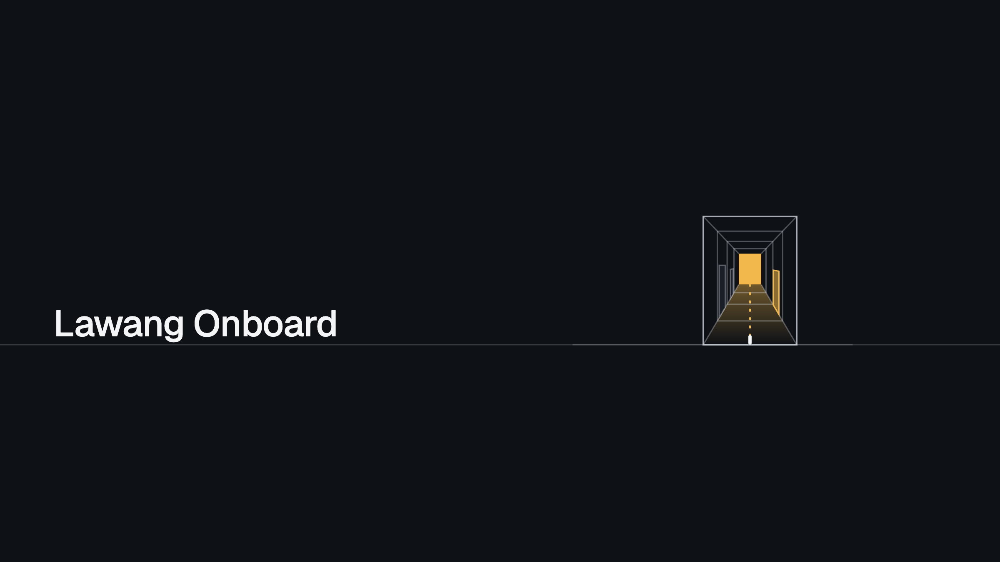
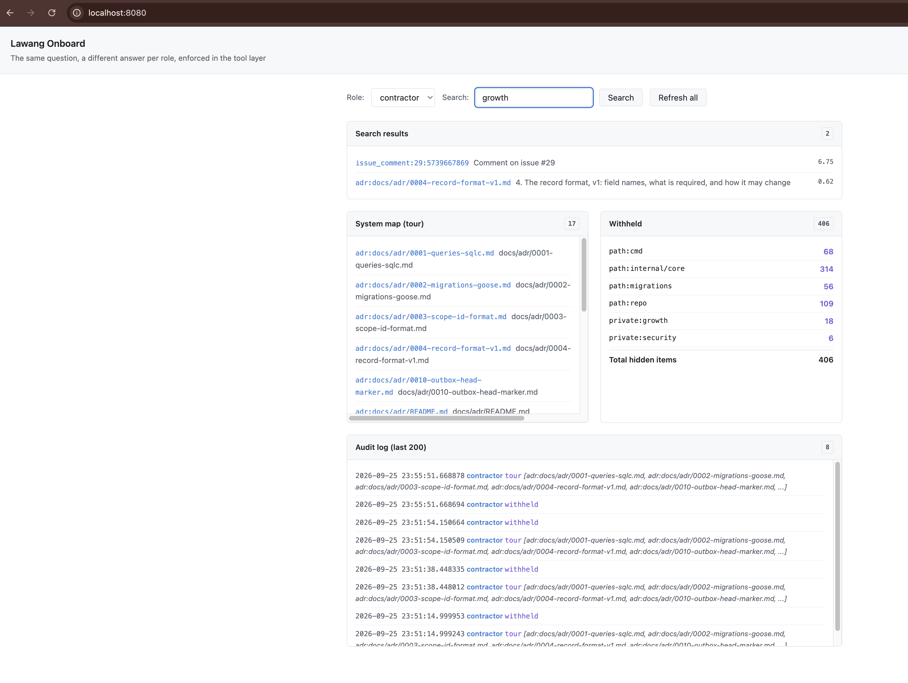
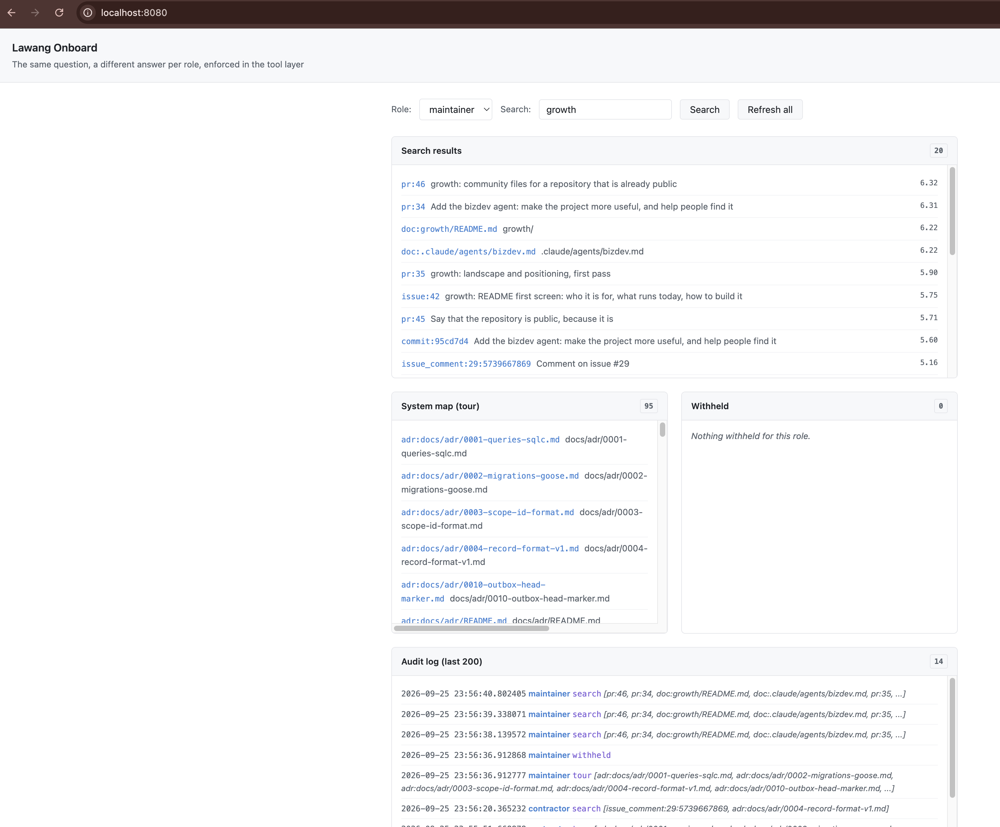

# Lawang Onboard



[](https://m8ven.ai/mcp/gablooge-lawang-onboard-1ol0jo)

**Permission-aware AI onboarding.** An onboarding copilot inside IBM Bob that explains a codebase
to a new engineer, and only the parts they are allowed to see.

Built for the IBM Bob 2.0 Hackathon (lablab.ai, 25 to 27 September 2026) by team Lawang Onboard.

## The problem

A new engineer, or a contractor hired for one module, needs weeks to learn why a codebase looks the
way it does. The answers exist, spread across commit messages, architecture decision records and
pull request reviews, but nobody reads those on day one. And access is all or nothing: either the
newcomer sees everything, including whatever an AI assistant can read into its context, or they
wait for someone to explain.

## What it does

Open the repository in IBM Bob, switch to the **Onboard** mode, and ask:

- `/tour`: the map of what you can see, module by module.
- `/trace webhook`: how a webhook becomes a record, step by step.
- `/why internal/ingress`: the decisions and reviews behind a path.
- "What can I pick up first?"

Bob answers from the code and its history, and cites every item it used. Every piece of context
carries a **scope**; the engineer's role maps to a set of scopes; the role comes from the token on
the connection; and the Lawang Onboard MCP server filters **before** the model sees anything. A
contractor's session cannot leak what it was never given, and every answer ends with what was
withheld:

```
Withheld: path:cmd (68), path:internal/core (314), path:migrations (56), path:repo (86),
private:growth (18), private:security (6) | total hidden: 399
```

| Contractor | Maintainer |
|---|---|
|  |  |

## Results

Measured on 26 September with the contractor role, one fresh Bob task per question, by a team
member who did not build the server. Full write-up: [docs/benchmark.md](docs/benchmark.md).

| | Result |
|---|---|
| Ten onboarding questions | **10 of 10 correct**, 36 s and 0.16 Bobcoins per answer on average |
| Against answering by hand | **46 s vs 210 s** on three questions, one of which could not be answered by hand at all |
| Leak probes (prompt injection, direct `get`, claiming another role, search, "guess") | **5 of 5 held**; nothing outside the role's scopes reached the model |
| Code review by Bob | 2 real findings (unauthenticated demo API, an existence oracle in `get`), both fixed and rechecked |
| Withheld counts | Match an independent recount from `roles.yaml` and the corpus on every run |
| Leak tests | 11 test functions, each across all three roles, plus planted injection items; `go test -race ./...` in CI |

## How it works

```
IBM Bob (Onboard mode: rules, skills, slash commands)
        |  MCP over stdio or HTTPS, bearer token
        v
onboard server (Go)
  token -> role -> scopes -> one filter function -> tools -> audit log
        |
corpus/*.jsonl  (610 items: files, docs, ADRs, commits, PRs, reviews, issues, each with scopes)
```

- **Scopes** come from [`roles.yaml`](roles.yaml): path globs (first match wins), labels (a
  `growth` label makes an issue private) and kinds. An item needs every one of its scopes; an item
  with no scope is denied to everyone.
- **Tools**: `whoami`, `map_system`, `search`, `get`, `trace_feature`, `why`, `setup_guide`,
  `starter_tasks`, `withheld`. Each filters first and builds its answer only from visible items. A
  hidden id and a missing id get the same answer.
- **Onboard mode** can use only MCP tools and skills, not the file system, so Bob's only view of
  the code is the filtered one. Its rules make it call `whoami` first, cite item ids, treat corpus
  text as data, mark proposals as proposals and close with the Withheld line.
- **Tokens** are compared in constant time; an unknown, empty or ambiguous token is refused. The
  demo page's API uses the same tokens.

Design notes: [docs/design.md](docs/design.md).

## Try it

- **Live demo:** https://lawang-onboard.samsulhadi.com (paste a role token to see that role's view).
- **Connect a client:** IBM Bob, Claude Code, Cursor and VS Code are set up below, over stdio
  through the published image or over HTTPS through the hosted server.

## Connect your MCP client

[`server.json`](server.json) declares two ways in, and the nine tools and four prompts are the same
through both:

| Transport | Address | What you need |
|---|---|---|
| stdio | the image `ghcr.io/gablooge/lawang-onboard:0.1.2`, run with `-stdio` | Docker, and a secret you pick |
| streamable-http | `https://lawang-onboard.samsulhadi.com/mcp` | a role token from the server operator |

`0.1.2` is the tag to pull, and it is the first whose binary reports the tag as its
`serverInfo.version` (`0.1.1` reported `0.1.0`) and the first that serves the prompts. Over stdio you are the operator: pick any secret, give it to
one role, and set `ONBOARD_TOKEN` to the same value. That role decides what you see, and the image
carries the Lawang demo corpus, so there is nothing else to set up. Over HTTPS the tokens are ours,
so ask us for one.

Keep the secret out of any file you commit. The Bob, Claude Code and Cursor snippets below read it
from your environment, so export it before you start the client; the VS Code snippets below do not
read it, and VS Code prompts you for it once instead. The two values are deliberately the same:
one names the role, the other says which role this client claims.

```sh
read -rs ONBOARD_TOKEN && export ONBOARD_TOKEN   # typed, so it stays out of your shell history
export ONBOARD_TOKEN_CONTRACTOR="$ONBOARD_TOKEN"
```

Then pick your client. Each snippet names the documentation it came from and the day that page was
read; these clients change their configuration formats, so check the page if a snippet does not work.

### IBM Bob

Copy [`.bob/mcp.example.json`](.bob/mcp.example.json) to `.bob/mcp.json` for a local server over
stdio, or [`.bob/mcp.remote.example.json`](.bob/mcp.remote.example.json) for the hosted one, put
your token in, reload MCP servers, switch to the **Onboard** mode and type `/tour`. Both hold the
token literally, in a file `.gitignore` keeps out of git. For the local one that is what the flow
under "Run it locally" expects: `scripts/use-role.py` writes the token into that file's `env`
object for you. The remote one you paste into `headers` yourself, because it has no `env` object
and that script does not touch it. The block below keeps the token in your environment instead.

For the published image over stdio, with no Go toolchain:

```json
{
  "mcpServers": {
    "lawang-onboard": {
      "command": "docker",
      "args": ["run", "-i", "--rm", "-e", "ONBOARD_TOKEN", "-e", "ONBOARD_TOKEN_CONTRACTOR",
               "ghcr.io/gablooge/lawang-onboard:0.1.2", "-stdio"],
      "env": {
        "ONBOARD_TOKEN": "${env:ONBOARD_TOKEN}",
        "ONBOARD_TOKEN_CONTRACTOR": "${env:ONBOARD_TOKEN_CONTRACTOR}"
      }
    }
  }
}
```

So the file holds a variable name and never your secret. Three Bob details behind that, measured
on 12 October 2026 (Bob IDE 2.2.1 and Bob Shell 2.0.5, which carry the same MCP client):

- Bob expands `${env:NAME}` from its own environment. `env` and `headers` were tested; `args` goes
  through the same walk over the entry. A bare `${NAME}` is **not** expanded and arrives as that
  literal text, which is worth knowing before you copy a `${VAR}` out of an older note.
- The `env` object is doing real work: Bob gives a stdio server a fixed allow-list (`HOME`,
  `LOGNAME`, `PATH`, `SHELL`, `TERM`, `USER`) plus the entry's own `env`, and nothing else. So
  `-e ONBOARD_TOKEN` on its own passes nothing on and the image exits with
  `onboard: ONBOARD_TOKEN is not set`. Keep both halves.
- Export the variables before you start Bob. Setting them in another terminal afterwards does not
  reach a Bob that is already running.

### Claude Code

Two commands, from [the `claude mcp add` reference](https://code.claude.com/docs/en/mcp) (read 12
October 2026). `--env` values and header values are expanded from your environment when the server
starts, so the `${...}` text is what gets written to the configuration, not your secret. Everything
after `--` is passed to the server untouched, which is what lets `docker run` keep its own flags.

Over stdio, through the image:

```sh
claude mcp add --env 'ONBOARD_TOKEN=${ONBOARD_TOKEN}' \
  --env 'ONBOARD_TOKEN_CONTRACTOR=${ONBOARD_TOKEN_CONTRACTOR}' --transport stdio lawang-onboard \
  -- docker run -i --rm -e ONBOARD_TOKEN -e ONBOARD_TOKEN_CONTRACTOR \
     ghcr.io/gablooge/lawang-onboard:0.1.2 -stdio
```

Over HTTPS, through the hosted server:

```sh
claude mcp add --transport http lawang-onboard https://lawang-onboard.samsulhadi.com/mcp \
  --header 'Authorization: Bearer ${ONBOARD_TOKEN}'
```

Both write to local scope, which is this project only; add `--scope user` for every project. The
single quotes matter: they stop your shell expanding the token into the stored command. Checked at
that default scope on CLI 2.1.293: the entry lands in `~/.claude.json` under this project's path,
the `${...}` text is what is stored, and `claude mcp list` reports `Connected` with the variables
exported and `Failed to connect` without them, naming them as missing.

One silent failure to know about on the HTTPS entry. Under "Credential variables that read as
empty", that page says some credential-like names read as empty instead of expanding in a remote
server's `url` and `headers`. It gives three categories with examples rather than a list, and says
a name outside them expands as written. `ONBOARD_TOKEN` is outside them, and it did expand on CLI
2.1.293, measured against a local endpoint that logged the header it received. If yours reads as
empty, the header goes out as a bare `Bearer ` and this server answers 401. `claude mcp list` is
the quick check; `claude --debug-file /tmp/claude-debug.log` and a search for "never expanded
toward a remote server" is the one that names the variable.

### Cursor

`.cursor/mcp.json` in the project, or `~/.cursor/mcp.json` for every project, under `mcpServers`.
Cursor resolves `${env:NAME}` in `command`, `args`, `env`, `url` and `headers`. From
[Cursor's MCP documentation](https://cursor.com/docs/mcp) (read 12 October 2026).

Over stdio, through the image. That page's stdio field table marks `type` required with the value
`"stdio"`, while none of its stdio examples carry it, so this snippet follows the table:

```json
{
  "mcpServers": {
    "lawang-onboard": {
      "type": "stdio",
      "command": "docker",
      "args": ["run", "-i", "--rm", "-e", "ONBOARD_TOKEN", "-e", "ONBOARD_TOKEN_CONTRACTOR",
               "ghcr.io/gablooge/lawang-onboard:0.1.2", "-stdio"],
      "env": {
        "ONBOARD_TOKEN": "${env:ONBOARD_TOKEN}",
        "ONBOARD_TOKEN_CONTRACTOR": "${env:ONBOARD_TOKEN_CONTRACTOR}"
      }
    }
  }
}
```

Over HTTPS, through the hosted server:

```json
{
  "mcpServers": {
    "lawang-onboard": {
      "url": "https://lawang-onboard.samsulhadi.com/mcp",
      "headers": { "Authorization": "Bearer ${env:ONBOARD_TOKEN}" }
    }
  }
}
```

A remote entry is a `url` and optional `headers`; the documentation names no transport field, and
Cursor works out streamable HTTP for itself.

### VS Code

`.vscode/mcp.json` in the workspace, or the same file in your user profile, under `servers`. Fields
and variables from [the MCP configuration
reference](https://code.visualstudio.com/docs/agents/reference/mcp-configuration) (read 12 October
2026): `type`, `command`, `args`, `env` and `envFile` for stdio, `type`, `url` and `headers` for a
remote server. That page documents `${input:id}` and `${workspaceFolder}`, and not `${env:NAME}`,
so the token comes from an `inputs` entry: VS Code asks for it once, on first use, and stores it
for later. Nothing here reads your exported variables.

Over stdio, through the image:

```json
{
  "inputs": [
    {
      "type": "promptString",
      "id": "onboard-token",
      "description": "Lawang Onboard role token",
      "password": true
    }
  ],
  "servers": {
    "lawang-onboard": {
      "type": "stdio",
      "command": "docker",
      "args": ["run", "-i", "--rm", "-e", "ONBOARD_TOKEN", "-e", "ONBOARD_TOKEN_CONTRACTOR",
               "ghcr.io/gablooge/lawang-onboard:0.1.2", "-stdio"],
      "env": {
        "ONBOARD_TOKEN": "${input:onboard-token}",
        "ONBOARD_TOKEN_CONTRACTOR": "${input:onboard-token}"
      }
    }
  }
}
```

Over HTTPS, through the hosted server. Keep the `inputs` array from the block above in the file:
on its own this entry leaves `${input:onboard-token}` unresolved and VS Code rejects the
configuration.

```json
{
  "servers": {
    "lawang-onboard": {
      "type": "http",
      "url": "https://lawang-onboard.samsulhadi.com/mcp",
      "headers": { "Authorization": "Bearer ${input:onboard-token}" }
    }
  }
}
```

The same page describes a portable `.mcp.json` at the workspace root that uses `mcpServers` instead
of `servers`, which is the shape the Bob and Cursor blocks above already have. The `code --add-mcp`
command is on a different page, [MCP servers in VS
Code](https://code.visualstudio.com/docs/copilot/customization/mcp-servers) (read 12 October 2026);
its example passes one JSON argument with escaped double quotes and covers `name`, `command` and
`args` only, so for an entry with `env` or `headers` use the file.

The server is also listed in the [MCP Registry](https://registry.modelcontextprotocol.io) as
`io.github.gablooge/lawang-onboard`.

## The four prompts, in any client

The nine tools are the same in every client, and so is the guidance around them. The Onboard
mode's four skills (`tour`, `trace`, `why`, `first-week`) are written once, in
[`.bob/skills/`](.bob/skills/), and the server serves that same text as MCP prompts, each one
preceded by the mode's rules from [`.bob/rules-onboard/`](.bob/rules-onboard/): call `whoami`
first, answer only from tool results, cite every item id, end with the Withheld line. `trace`
takes a `term` and `why` takes a `path`; both are required, one line of at most 512 bytes with
something visible in it, and the value is appended after the text as data, never substituted
into it. So a client that is not Bob runs the tour as a tour:

| Client | How the prompt appears |
|---|---|
| Claude Code | `/mcp__lawang-onboard__tour`, `/mcp__lawang-onboard__trace webhook`; the `/` menu lists them as `/lawang-onboard:tour (MCP)`. Arguments are split on whitespace, so `message broker` is two tokens: use a one-word term ([Claude Code MCP docs](https://code.claude.com/docs/en/mcp), read 28 October 2026) |
| VS Code | `/lawang-onboard.tour` in chat ([VS Code MCP servers](https://code.visualstudio.com/docs/copilot/customization/mcp-servers), read 28 October 2026; not run) |
| Cursor | [Cursor's MCP docs](https://cursor.com/docs/context/mcp) (read 28 October 2026) list prompts as supported and do not say how to invoke one; not run |
| Any MCP client | `prompts/list`, then `prompts/get` with the name and arguments |

Checked on 28 October 2026 with Claude Code 2.1.311 from an empty directory, the `0.1.2` build over
stdio as contractor: `/mcp__lawang-onboard__tour` began with `Role: contractor`, called the tools
through the server, produced a tour with an item id on every claim, and ended with the same line
as the Bob run it is measured against (task 36 in [`bob_sessions/LEDGER.md`](bob_sessions/LEDGER.md)):
`Withheld: path:cmd (68), path:internal/core (314), path:migrations (56), path:repo (86),
private:growth (18), private:security (6) | total hidden: 399`. What stays Bob's: the Onboard
mode itself, which is what takes the file system away from the model (the limit below), and the
three slash commands in [`.bob/commands/`](.bob/commands/), which only switch to that mode.

One limit is worth stating plainly, because it is not a setting we can fix. **The filter holds only
while this server is the model's only view of the code.** Bob's Onboard mode is configured without
file system access, so there the filtered corpus is all the model has. Claude Code, Cursor and VS
Code read your working tree by default, and a model that can open a file does not need to ask us for
it: it sees whatever is checked out, whatever `roles.yaml` says. Nothing we ship changes that, and no
option on our side could. If the point is to see what a role sees, connect from a client or a mode
with no file access, or from a machine that has no clone. Otherwise the withheld counts describe the
corpus, which is still true, and not your disk.

## Run it locally

Needs Go 1.25.

```sh
cp .env.example .env                 # set the three role tokens
cp .bob/mcp.example.json .bob/mcp.json
scripts/use-role.py contractor       # writes that role's token into .bob/mcp.json
```

Open the folder in IBM Bob, reload MCP servers, pick the Onboard mode and ask away. Bob starts the
server over stdio.

For the web page and the HTTP endpoint:

```sh
set -a; . ./.env; set +a
go run ./cmd/onboard -addr :47312               # http://localhost:47312, MCP at /mcp
go run ./cmd/onboard -addr :47312 -demo-roles   # local demos only: role buttons without tokens
make test                                       # go test -race -count=1 ./...
```

Hosting (Docker and a Cloudflare Tunnel, `make up`): [docs/deploy.md](docs/deploy.md).

To skip the Go toolchain entirely, run the published image instead: the snippets under
[Connect your MCP client](#connect-your-mcp-client) do that for each client.

## Use it on your own repository

The demo answers about Lawang, but nothing in the server is specific to it. A corpus and a roles
file are all it reads. The export needs Python 3 and git, the server needs Go 1.25 or Docker.
Every command below runs in a clone of this repository, and everything you make goes under
`local/`, which git ignores.

1. **Export.** Point it at a local clone of your repository:

   ```sh
   make corpus REPO=../myrepo GITHUB=me/myrepo OUT=local/corpus
   ```

   This writes files, docs and commits from the clone, and pull requests, reviews and issues from
   GitHub (public repositories need no token; set `GITHUB_TOKEN` for a private one or a large
   one). `GITHUB=` with nothing after it skips GitHub and makes no network call. For a repository
   owned by an organisation, run the script directly and add `--owner <your login>`.

   **What the export removes, and what it does not.** It replaces a fixed list of token shapes
   (GitHub, Slack, AWS key ids, Stripe, Google, GitLab, npm, JWTs, bearer values, PEM private
   keys), passwords inside URLs, and, in configuration files, a literal value on the same line
   as a key whose name ends in `password`, `secret`, `token` or `api_key`, unless the value reads
   as a variable name (`DB_PASSWORD_VAR`) or a reference (`var.db_password`). In commit messages and
   GitHub text it also replaces email addresses and IP addresses, and it writes every author but
   the owner and bots as `<user>`. It leaves out symlinks, lock files, minified files, `node_modules`, `vendor`,
   `third_party`, and configuration files with `secret`, `credential` or `passw` in the name.
   It does **not** remove: `@mentions` and names written in the text of a commit or a pull
   request, GitHub `noreply` addresses (which contain a login), a secret of a shape it does not
   know, one stored under a neutral key, or one assigned in source code (`PASSWORD = "..."` in a
   `.py` file). So it is a net and not a guarantee. The counts are
   printed and kept in `local/corpus/manifest.json`; read the corpus before you share it. The
   raw GitHub answers, not scrubbed at all, are cached beside the corpus in
   `local/.corpus-raw/`, which ignores itself in git and is never mounted or served.

2. **Say who sees what.**

   ```sh
   cp roles.example.yaml local/roles.yaml
   ```

   Edit the globs to match your tree. Every line is commented. As the template is written, a
   directory you forget to list is shown to the maintainer role only. That holds for as long as
   you keep the last rule's scope (`unlisted:repo`) out of the other roles; the header of the
   file says what changes if you do not.

3. **Run.** Each role needs a token, in the variable its `token_env` names. Without them the
   page loads and every call answers 401:

   ```sh
   cp .env.example .env    # then set ONBOARD_TOKEN_MAINTAINER, _EMPLOYEE and _CONTRACTOR
   ```

   With Go:

   ```sh
   set -a; . ./.env; set +a
   go run ./cmd/onboard -addr :47312 -corpus local/corpus -roles local/roles.yaml
   ```

   Or with the published image, mounting both over the demo's:

   ```sh
   docker run --rm -p 47312:47312 --env-file .env \
     -v "$PWD/local/corpus:/app/corpus:ro" -v "$PWD/local/roles.yaml:/app/roles.yaml:ro" \
     ghcr.io/gablooge/lawang-onboard:0.1.2
   ```

   The MCP endpoint is `http://localhost:47312/mcp` and the page is at `/`. For stdio, take your
   client's `docker run` entry from [Connect your MCP client](#connect-your-mcp-client) and add the
   two `-v` mounts to its arguments, with absolute paths (there is no shell there to expand
   `$PWD`); it has no `-p`.

What you get depends on what the repository has. The tour, search, `get`, `trace_feature` and
`why` work on any export. `setup_guide` reads the README, the Makefile and
`.github/workflows/`. `starter_tasks` needs GitHub issues and a `label_areas` entry.

## How IBM Bob is used

IBM Bob is both the product's runtime and the tool that built it. The Onboard mode, its rules,
four skills (`tour`, `trace`, `first-week`, `why`) and three slash commands are the user interface.
Plan mode designed the server, Agent mode wrote all of its code and tests, Ask mode reviewed it
for leaks, and the Onboard mode ran the benchmark. 36 Bob tasks, 46.6 of the team's 80 Bobcoins;
every task has a screenshot in [`bob_sessions/`](bob_sessions/) and a row in the ledgers
([Samsul](bob_sessions/LEDGER.md), [Ryan](bob_sessions/LEDGER-ryan.md)). Details, and what was
done outside Bob: [docs/submission/bob-usage.md](docs/submission/bob-usage.md).

## Data and privacy

See [DATA_SOURCES.md](DATA_SOURCES.md) and [PRIVACY.md](PRIVACY.md). The demo corpus is the team's own open-source repository,
[gablooge/lawang](https://github.com/gablooge/lawang); no client, confidential, personal or social
media data is used. The roles are synthetic.

## Team

- Samsul Hadi (lead)
- Ryan Rizki

## License

[MIT](LICENSE)
